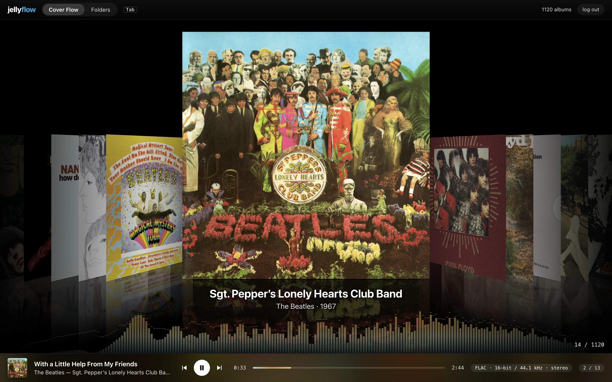
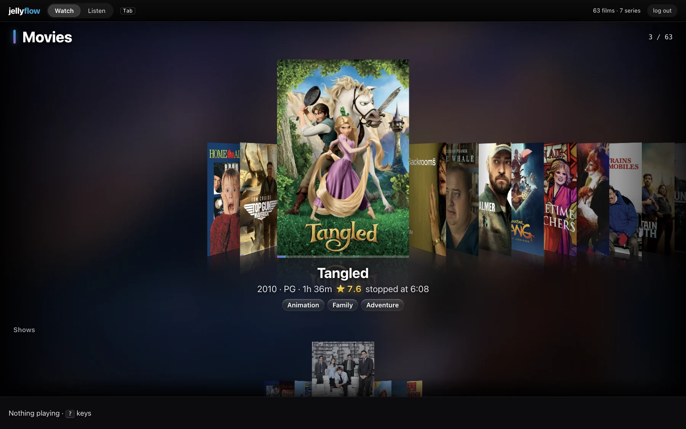
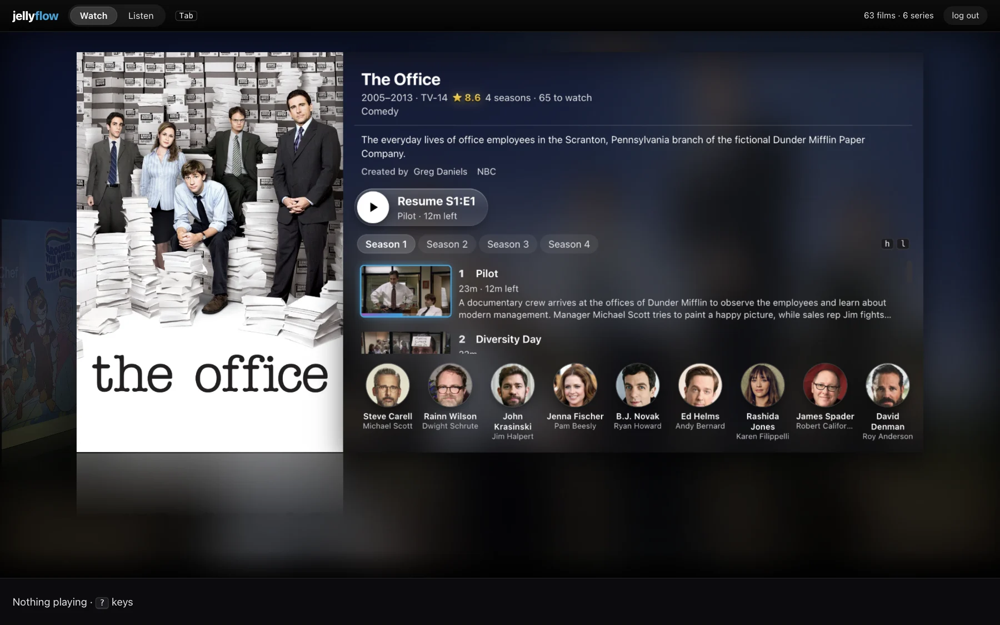

# jellyflow

Your [Jellyfin](https://jellyfin.org) music library, flipped through by album
cover (Cover Flow) or walked folder by folder with album art, all from the
keyboard with vim keys. Your films and series too, in rows of posters like
Netflix's, with a player that sends them as they are. It's the web sibling of
[coverflow](https://github.com/popconst/coverflow), the MPD terminal app,
with the same keys. A terminal version comes next and shares the same core.



<table>
  <tr>
    <td width="50%"></td>
    <td width="50%"></td>
  </tr>
  <tr>
    <td align="center"><code>Enter</code> opens an album like a gatefold sleeve</td>
    <td align="center">Folders, with vim motions</td>
  </tr>
</table>



<table>
  <tr>
    <td width="50%"></td>
    <td width="50%"></td>
  </tr>
  <tr>
    <td align="center">A film's page swings out beside its poster</td>
    <td align="center">A series': where you're at, its episodes, its cast</td>
  </tr>
</table>

- **Cover Flow:** a 3D row of covers that glides on a tap and runs ever
  faster while a key is held. `Enter` opens an album like a gatefold sleeve,
  its tracks on the inside page.
- **Folders:** the library as it is on disk, in columns like ranger or yazi,
  with album art throughout.
- **Search** by artist, album, year or any track title.
- **Playback** in the browser, the files streamed as they are (not
  transcoded), with the OS's media keys.
- **A spectrum** of what's playing, in the colours of the album's cover.
- **Remembers** what was playing and where you were, across reloads.
- **Out of the way:** with an album or a title open, the header and the
  player bar glide away after a few seconds of nothing; any move brings
  them back.
- **Watch:** films and series in rows, Netflix style, each row a Cover Flow
  of posters: Continue Watching (`x` takes one off), Movies and Shows newest
  first, then Documentaries, Kids, Action, Comedy, Drama and Thriller (each
  title in one of them). The row you're on takes most of the screen, the
  title in the middle captioned with its year, rating and main genres. A
  series' page has its seasons and episodes;
  the next episode follows by itself. The player has YouTube's keys; the
  picture is never re-encoded, and sound the browser can't play (Dolby, DTS)
  is converted to FLAC, losing nothing. Audio and subtitle choice is kept
  from one to the next, and it resumes where you stopped, in any Jellyfin
  app.
- **Light:** two runtime dependencies, and no backend of its own. The page
  talks to your Jellyfin directly.

## Requirements

- A Jellyfin server with a music library, film or series libraries, or both.
  Developed against Jellyfin 12.4.
- Node.js 22.18 or newer, to build and serve it. Node runs the TypeScript as
  it is.
- A recent Chromium browser (Chrome, Brave): that's where it's developed and
  tested.

## Quick start

```sh
git clone https://github.com/popconst/jellyflow && cd jellyflow
npm install
npm run dev                    # http://localhost:5173, reloads as you edit
```

Log in with your Jellyfin server's address, user and password. To start the
login screen with your server filled in:

```sh
cp .env.example .env.local     # then set VITE_JELLYFIN_URL
```

The page talks to Jellyfin straight from the browser, so Jellyfin's CORS has
to allow it. Jellyfin allows any origin by default.

## Run it as a service

```sh
npm run build && npm start     # http://127.0.0.1:4173
```

`HOST` and `PORT` change where it listens. `server.ts` only serves the built
files and has no dependencies. To keep it running with
[pm2](https://pm2.keymetrics.io):

```sh
npm run build && pm2 start ecosystem.config.cjs
```

A rebuild is a redeploy: the server always serves what's in `dist/`.

## Keys

`?` shows them all. `Tab` switches between Watch and Listen; in Listen,
`Shift-Tab` switches between Cover Flow and Folders.

**Everywhere:**
- `Space`: play / pause.
- `<` `>`: previous / next track.
- `c`: go to what's playing: its album glides into the middle and opens at the track, as a click on its cover would. `o` goes back to where you were before (`o` again: back to what's playing).
- `a`: add to the queue.
- `i`: the album's details. `d`, `w` and `m` open the album on Discogs, Wikipedia and MusicBrainz.

**Cover Flow** (coverflow's keys):

| Key | |
|---|---|
| `h` `l` / `←` `→` | previous / next album; hold to run, ever faster. Also scroll. A click on a cover opens it |
| `H` `L` / PgUp PgDn | 10 back / forward |
| `g` `G` | first / last |
| `/` | filter by artist, album, year or track title (words in any order). `Enter` browses the matches, `Esc` cancels, `Ctrl-U` clears |
| `Esc` | the whole library again, at the same album |
| `Enter` `j` | open the album: a page with its tracks swings out beside the cover, with the spectrum of what's playing under them. On it, `j` / `k` move, `Enter` plays from there (so `Enter` `Enter` plays the album), and `k` on the first track, `Esc` or a click away folds it shut |

**Folders** (like ranger or yazi: the folder above, this folder, and a preview):

| Key | |
|---|---|
| `j` `k` | down / up; counts work (`5j`) |
| `l` `h` | open / back up (also `-` and `Backspace`) |
| `Enter` | play the album, or the folder from this track |
| `gg` `G` `12G` | first / last / item 12 |
| `Ctrl-d` `Ctrl-u` `Ctrl-f` `Ctrl-b` | half page / page, down and up |
| `H` `M` `L` `zz` | top / middle / bottom of the screen; centre the cursor |
| `/` `n` `N` | find in this folder; next and previous match |
| `~` | the top folder |

**Watch** (rows of posters, each a Cover Flow):

| Key | |
|---|---|
| `h` `l` / `←` `→` | previous / next in the row; hold to run. Also scroll sideways. A click on a poster opens it |
| `j` `k` / `↓` `↑` | the next row / the one above. Also scroll up and down |
| `H` `L` `g` `G` | 10 back / forward; first / last in the row |
| `Enter` | open it: its row comes forward and a page swings out beside the poster. A film's has what it's about, who made it, its cast and Resume or Play; a series' has where you're at, its seasons (`h` `l`), episodes (`j` `k`) and cast. `Enter` plays; `k` on the first line, `Esc` or a click away folds it shut |
| `x` / `u` | take it off Continue Watching (until you watch it again) / put it back |
| `/` | find a film or series by title, year or genre; `Esc` brings the rows back |

**Watching** (YouTube's keys):

| Key | |
|---|---|
| `Space` `k` | play / pause |
| `j` `l` / `←` `→` | 10 s back / ahead; 5 s with the arrows |
| `0` … `9` | to 0% … 90% of the film |
| `↑` `↓` `m` | volume, mute |
| `c` | subtitles on / off |
| `a` / `s` | the next audio track / the menu: quality, audio, subtitles |
| `f` | full screen |
| `N` | the next episode. At the end of one, the next starts after 8 seconds (`Enter` now, `Esc` back) |
| `Esc` `q` | back to the rows |

## How it works

- **Albums** are Jellyfin's music albums, minus anything under a `Playlists/`
  folder. They're sorted by year, oldest first (albums without a year last),
  then by title, then by artist.
  - The year is the album folder's `YYYY - ` prefix when it has one (the
    original release), else the tags' year. The details show both when they
    differ.
- **Search by track** uses every track title in the library. The titles load
  in the background after the albums, a page at a time.
- **Live reload:** Jellyfin's websocket says when the library changed. Once
  the changes settle, both views read it again and stay where they were.
- **Folders** are the library's folders as they are on disk. A folder without
  a cover of its own shows up to four covers of the albums under it.
- **Playing** happens in the browser: a queue, auto-advance, and the OS's
  media keys and now-playing panel. Tracks are streamed as the files are
  (FLAC, MP3, …), not transcoded. The sound goes through Web Audio untouched,
  which the spectrum
  ([audioMotion-analyzer](https://github.com/hvianna/audioMotion-analyzer),
  1/24-octave bands coloured from the cover) listens to.
- **Remembered across reloads:** what's playing (the queue, the track and the
  second it was at), where Cover Flow was (album and filter), and the open
  folder with its cursor. If something was playing, it plays on and Cover
  Flow opens its album. The browser has to allow the site to start sound by
  itself (in Brave: site settings → Autoplay → Allow; Chrome has no such
  setting); if it doesn't, the player bar says so and it plays on at the
  first key press or click, from the same second.

- **Films** are streamed the way Jellyfin's own apps ask for them, with a
  device profile (`src/core/playback.ts`). The browser says what it plays;
  Jellyfin repackages the MKV into HLS (fragmented MP4) and copies the
  picture untouched: H.264, HEVC 10-bit, HDR10 and Dolby Vision with an
  HDR10 picture under it. Sound the browser plays is copied too (AAC, and
  Dolby in Safari); anything else is decoded to FLAC, which keeps exactly
  what the track holds and every channel. Only Dolby Vision with no HDR10
  under it, and picture subtitles (Blu-ray PGS) if you pick them, make
  Jellyfin re-encode the picture. The player's menu (`s`) says what it
  does to the film you're watching. [hls.js](https://github.com/video-dev/hls.js)
  plays the stream where the browser doesn't play HLS itself, loaded only
  when a film starts.
- **Where a film or an episode was stopped** goes to Jellyfin as it plays,
  so it resumes there in jellyflow and in Jellyfin's other apps; the audio
  and subtitle languages you chose are kept for the next one. Text
  subtitles come as WebVTT and are drawn by the player.
- **The rows** (`src/core/shelves.ts`): Continue Watching has the films
  stopped partway and the series being watched, at the episode to pick
  them up at (the one stopped partway, else the one after the last
  watched), the latest first. The films' and the series' rows are newest
  first. Each title goes in one genre row: Kids if it's for kids (a
  children's series; a family film not rated PG-13 or up; a cartoon rated
  G or PG), else Documentaries, else the first of its genres that's
  Action, Comedy, Drama or Thriller, else the nearest of those to its
  other genres (Crime and Horror count as Thriller, Adventure and Science
  Fiction as Action, Romance and History as Drama). A library without
  genres (courses, say) isn't in Watch, Continue Watching included. What
  `x` takes off Continue Watching is kept in Jellyfin, with jellyflow's
  display settings, so every browser you log in from leaves it off;
  watching it again brings it back.
- **Bandwidth:** the picture is sent as it is in the file, so the network
  between the browser and Jellyfin has to carry the film's bitrate (a 4K
  film's can pass 50 Mbit/s for a while). On a slow link, choose a lower
  quality in the menu (`s`): Jellyfin's own choices, from 4K at 120 Mbps
  down to 360p at 420 kbps, those at or under the film's size. Jellyfin
  then re-encodes the picture to fit (tone-mapping HDR, if it's set to);
  under 10 Mbps the sound comes as AAC rather than lossless. The choice
  is kept on that browser, for the next film.

## Privacy

Everything stays between your browser and your Jellyfin. The login (server,
user name and access token) and what's remembered across reloads are kept
in the browser's `localStorage`; logging out ends the session on the server
too. Nothing is sent anywhere else, except that `d` / `w` / `m` and the
details' links open the album on Discogs, Wikipedia or MusicBrainz when you
ask for them.

## Layout

```
src/core/   Jellyfin client, albums + search, details, vim key sequences,
            the row's motion; films, series and their rows, what a title's
            page offers to play, the device profile and subtitles. No DOM:
            plain TypeScript that Node runs as it is (type stripping), to
            be shared with the terminal app. tsconfig.core.json checks it
            without DOM types.
src/web/    Svelte 5 app: Watch (the rows, a title's page), Cover Flow,
            Folders, the players, the spectrum.
server.ts   serves dist/ (no dependencies)
```

The runtime dependencies are audioMotion-analyzer (the spectrum, with no
dependencies of its own) and hls.js (films, loaded only when one plays).
Svelte, Vite and TypeScript are dev dependencies.

## Develop

```sh
npm run dev      # Vite, with hot reload
npm run check    # svelte-check (strict, warnings fail) + the core without the DOM
npm test         # node --test on src/core
npm run build    # into dist/
```

With `npm run dev`, `localStorage.setItem('jellyflow.debug', 'hls')` in the
console makes hls.js log what it loads and decides, for a film that won't
start.

CI runs `check`, `test` and `build` on every push and pull request. Issues
and pull requests are welcome. Keep it light: new runtime dependencies need
a good reason.

## Next: the terminal

The terminal app will be `src/tui/`, run by Node, on the same `src/core`. Its
pieces:
- the same views drawn with kitty graphics (like coverflow);
- playback through `mpv --input-ipc-server` on `Jellyfin.streamUrl()`.

## License

[MIT](LICENSE)
