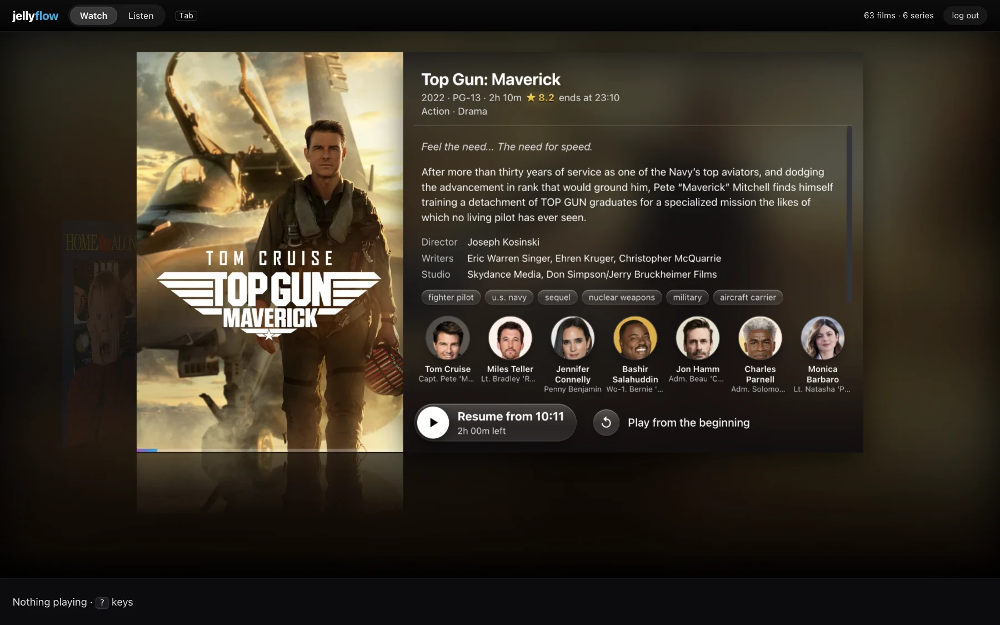
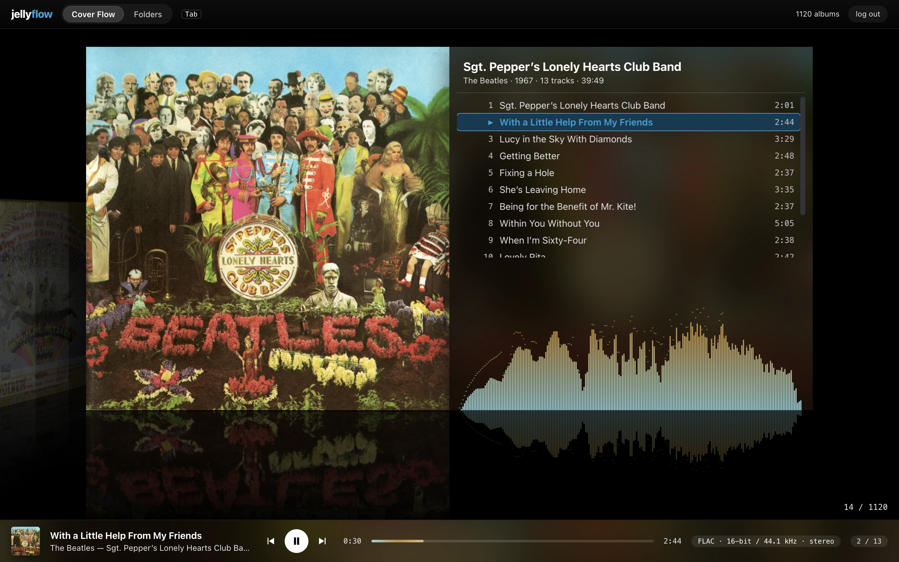

# jellyflow

A web client for [Jellyfin](https://jellyfin.org) that you drive from the
keyboard, with vim keys.

- **Watch:** your films and series in rows of posters, Netflix style, each
  row a Cover Flow. The player sends the picture as it is in the file.
- **Discover:** films and series beyond your library, from TMDB: the best
  films and series (3+ seasons) of each year, from this one back, in the
  same rows, with a wishlist. It's optional, through jellyflow's own server.
- **Listen:** your music, flipped through by album cover (Cover Flow) or
  walked folder by folder with album art.

It's the web sibling of [coverflow](https://github.com/popconst/coverflow),
the MPD terminal app, with the same keys. A terminal version comes next and
shares the same core.


## Watch

<table>
  <tr>
    <td width="50%"></td>
    <td width="50%"></td>
  </tr>
  <tr>
    <td align="center">A film's page swings out beside its poster</td>
    <td align="center">A series': where you're at, its episodes, its cast</td>
  </tr>
</table>

- **Rows:** Continue Watching first, then Movies and Shows, newest first.
  Then Documentaries, Kids, Action, Comedy, Drama and Thriller, with each
  title in one of them.
  - The row you're on takes most of the screen.
  - The title in the middle shows its year, rating and main genres under
    it.
  - `x` takes a title off Continue Watching until you watch it again.
- **A title's page** swings out beside its poster. It has what the title is
  about, who made it, its cast with their photos, and Resume or Play. A
  series' page also has where you're at, its seasons and its episodes.
- **The player** has YouTube's keys.
  - **Picture:** sent as it is in the file (H.264, HEVC, HDR10, Dolby
    Vision), unless you pick a lower quality for a slow link.
  - **Sound:** what the browser can't play (Dolby, DTS) is converted to
    FLAC, losing nothing.
  - **Subtitles:** text subtitles are drawn by the player.
- **Picks up where you stopped,** in jellyflow and in Jellyfin's other apps.
  The next episode follows by itself, and the audio and subtitle languages
  you chose carry over to the next film or episode.

## Discover

- **Movies or Series:** two tabs in the header (`Shift-Tab` switches);
  everything below, the wishlist and search too, is of the one shown.
- **Year by year:** this year and the three before at first. Down from the
  last row, the year before it is asked for, films and series at once, so
  the other tab has it too: one year at a time. Up to 100 in a row. An older year is kept on
  the server once worked out, and comes with the rest next time.
- **The best series** of each year, with 3 seasons
  out or more: each in the year it was last on, the year it ended or (still
  running) its latest season's. Of TMDB's most voted for that year (score
  7.5 or more from at least 200 votes), the best scored first; how many
  seasons, and whether it ended, under each.
- **The best films** of each year: TMDB score 7.2 or
  more from at least 200 votes: of the most popular, the best scored first.
- The lists are worked out when the server starts, and their posters
  fetched ahead and kept on the server, so Discover opens at once and a
  fast scroll along a row doesn't wait for TMDB.
- **The same rows as Watch,** with TMDB's posters, each title's score, how
  many voted and its genres. What you have carries a tick, what you wished
  for a heart.
- **A title's page**, like Watch's: what it's about, who made it, its cast,
  and its IMDb link (`i`).
- **A wishlist** (`w`), kept on jellyflow's server for each Jellyfin user,
  in its own row at the top, the best scored first like the rest.
- **Only what's new to you:** what's in your library or on your wishlist
  isn't in the year rows, nor what you're not interested in (`x`, which
  also takes it off your wishlist; `u` puts it back). Go along a row with
  `x` and `w` to clear it. A title's page holds its row still until it
  shuts.
- **Search** (`/`): any film or series on TMDB, by title, to look at or
  wish for.
- **Optional:** it needs jellyflow's server with a TMDB token ([below](#discover-and-the-wishlist-optional)).
  Without one there's no Discover, and nothing goes to TMDB.

## Listen


<table>
  <tr>
    <td width="50%"></td>
    <td width="50%"></td>
  </tr>
  <tr>
    <td align="center"><code>Enter</code> opens an album like a gatefold sleeve</td>
    <td align="center">Folders, with vim motions</td>
  </tr>
</table>

- **Cover Flow:** a 3D row of covers that glides on a tap and runs ever
  faster while a key is held. `Enter` opens an album like a gatefold sleeve,
  with its tracks on the inside page.
- **Folders:** the library as it is on disk, in columns like ranger or yazi,
  with album art throughout.
- **Playback** happens in the browser, with the OS's media keys and
  now-playing panel.
  - The files come as they are. Apple Lossless, which only Safari plays, is
    converted on the fly to FLAC, losing nothing.
  - The player bar shows each track's format, and what it's converted to
    if it is.
- **A spectrum** of what's playing, in the colours of the album's cover. A
  small one dances beside the track playing in a list.
- **Album details** (`i`): Jellyfin's overview, the tags, the audio quality,
  and links to Discogs, Wikipedia and MusicBrainz.

## Throughout

- **Keyboard first:** vim keys everywhere, and `?` lists them. The mouse
  works too: click a cover or a poster to open it, and click away to close
  it.
- **Search as you type.** Albums by artist, album, year or any track title;
  films and series by title, year or genre. Accents don't matter: `leon`
  finds Léon.
- **Remembers where you were** across reloads: what's playing, the second
  it was at, and your place in each view.
- **Live:** changes to the library, and what you watch in Jellyfin's other
  apps, show up by themselves.
- **Out of the way:** with an album or a title open, the header and the
  player bar glide away after a few seconds of nothing. Any move brings
  them back.
- **Light:** two runtime dependencies. The page talks to your Jellyfin
  directly; jellyflow's own small server only hands it its files, and
  Discover when it has a TMDB token.

## Requirements

- A Jellyfin server with film, series or music libraries. Developed against
  Jellyfin 12.4.
- Node.js 22.18 or newer, to build and serve it. Node runs the TypeScript as
  it is.
- A recent Chromium browser (Chrome, Brave): that's where it's developed and
  tested.

## Quick start

```sh
git clone https://github.com/popconst/jellyflow && cd jellyflow
npm install
npm run dev                    # http://localhost:5173, reloads as you edit
```

Log in with your Jellyfin server's address, user and password. To start the
login screen with your server filled in:

```sh
cp .env.example .env.local     # then set VITE_JELLYFIN_URL
```

The page talks to Jellyfin straight from the browser, so Jellyfin's CORS has
to allow it. Jellyfin allows any origin by default.

## Run it as a service

```sh
npm run build && npm start     # http://127.0.0.1:4173
```

`HOST` and `PORT` change where it listens. `server.ts` serves the built
files, and under `/api` what Jellyfin can't do: Discover and the wishlist
(below). It has no dependencies. To keep it running with
[pm2](https://pm2.keymetrics.io):

```sh
npm run build && pm2 start ecosystem.config.cjs
```

A rebuild is a redeploy: the server always serves what's in `dist/`.

### Discover and the wishlist (optional)

Films and series beyond your library come from [TMDB](https://www.themoviedb.org),
through the server, which holds your TMDB token so the browser never sees it.
Get a free API read access token (TMDB account → Settings → API), then on the
machine running the server:

```sh
mkdir -p ~/.config/jellyflow && (umask 077; cat > ~/.config/jellyflow/tmdb-token)   # paste it, then Ctrl-D
pm2 restart jellyflow
```

Without a token there's no Discover, and nothing goes to TMDB. The server
needs to reach Jellyfin too, to check who's asking (`JELLYFIN_URL`, by
default `http://127.0.0.1:8096`: Jellyfin on the same machine).

| Variable | Default | |
|---|---|---|
| `JELLYFIN_URL` | `http://127.0.0.1:8096` | Jellyfin, as the server reaches it |
| `TMDB_TOKEN_FILE` | `~/.config/jellyflow/tmdb-token` | the token (or `TMDB_TOKEN` itself) |
| `DATABASE` | `~/.local/share/jellyflow/jellyflow.db` | SQLite: TMDB's answers, the lists, the wishlist |
| `IMAGES` | `~/.cache/jellyflow/images` | TMDB's posters and backdrops, once fetched (safe to delete) |

The API, for jellyflow's page: every call but images sends the page's
Jellyfin login along (its `Authorization` header), and the server asks
Jellyfin whose it is, so each Jellyfin user has their own lists and
wishlist, and nobody without a login gets anything.

| | |
|---|---|
| `GET /api/me` | who's asking; whether Discover is on |
| `GET /api/discover` | the lists of the latest four years and the older ones worked out before, and the oldest year they're of (`?year=2022`: that year's alone; `?refresh=1`: worked out afresh) |
| `GET /api/wishlist` | the wishlist, newest first |
| `PUT /api/wishlist/{ref}` | add a film or series (`tmdb:movie:603`, `tmdb:tv:1399`) |
| `DELETE /api/wishlist/{ref}` | remove one |
| `GET /api/dismissed` | what you're not interested in |
| `PUT /api/dismissed/{ref}` | not interested (off the wishlist too) |
| `DELETE /api/dismissed/{ref}` | of interest again |
| `GET /api/search?q=…` | films and series on TMDB by title, marked as the lists are |
| `GET /api/tmdb/{path}` | TMDB itself, for a title's or a person's page (only what Discover reads) |
| `GET /api/img/{size}/{file}` | TMDB's posters and backdrops |

The lists Discover shows for now: the best series of each year (this one and
the three before at first, older ones as they're asked for), in the year each
was last on (3+ seasons out, TMDB score 7.5+ from
200+ votes; no news, reality, soaps or talk shows), and the best films of
those years (TMDB score 7.2+ from 200+ votes). The server can work out more,
from your library: new and coming from the directors and actors it's most
made of (weighed by what you watched), because you watched (your last
three), what's next for your series, in cinemas, coming soon and trending
(`ALL` in `server/discover.ts`; `SHOWN` is what's on). The latest four years'
lists are worked out again every 12 hours, in the background (the ones kept
are shown meanwhile); an older year's are kept as they
are (`?refresh=1` with its `?year=` works them out again). TMDB's answers
are kept from hours (lists) to a month (a film's credits).

## Keys

`?` shows them all.

**Everywhere:**
- `Tab`: the next of Watch, Discover and Listen.
- `Space`: play or pause the music.
- `<` `>`: previous or next track.

**Watch** (rows of posters, each a Cover Flow):

| Key | |
|---|---|
| `h` `l` / `←` `→` | previous / next in the row; hold to run. Also scroll sideways. A click on a poster opens it |
| `j` `k` / `↓` `↑` | the next row / the one above. Also scroll up and down |
| `H` `L` `g` `G` | 10 back / forward; first / last in the row |
| `Enter` | open it: its row comes forward and its page swings out beside the poster |
| `x` / `u` | take it off Continue Watching (until you watch it again) / put it back |
| `/` | find a film or series by title, year or genre; `Esc` brings the rows back |

**A title's page:**

| Key | |
|---|---|
| `j` `k` | Resume or Play, and a series' episodes; `k` at the top closes the page |
| `h` `l` | a series' seasons; on a film's page, the previous / next film |
| `Enter` | play it, or resume it where it was stopped |
| `i` | the film or series on IMDb (its link is in the page's corner) |
| `Esc` `q` | close the page (so does a click away) |

**Discover:** the rows' keys are Watch's.

| Key | |
|---|---|
| `Shift-Tab` | Movies ⇄ Series |
| `j` `↓` | from the last row: the year before it (films and series both) |
| `Enter` | open a film's or series' page |
| `w` | on your wishlist, or off it (`Enter` too, on a title's page) |
| `i` | on a title's page: the film or series on IMDb |
| `x` | not interested: it's left out of Discover (and off your wishlist); on a title's page, the page shuts too |
| `u` | puts back the last one you weren't interested in |
| `k` `Esc` `q` | close a title's page (so does a click away) |
| `/` | search all of TMDB by title; `Enter` browses what's found, `Esc` brings the rows back |

**Watching** (YouTube's keys):

| Key | |
|---|---|
| `Space` `k` | play / pause |
| `j` `l` / `←` `→` | 10 s back / ahead; 5 s with the arrows |
| `0` … `9` | to 0% … 90% of the film |
| `↑` `↓` `m` | volume, mute |
| `c` | subtitles on / off |
| `a` / `s` | the next audio track / the menu: quality, audio, subtitles |
| `f` | full screen |
| `N` | the next episode. At the end of one, the next starts after 8 seconds (`Enter` now, `Esc` back) |
| `Esc` `q` | back to the rows |

**Listen**, in both Cover Flow and Folders:
- `Shift-Tab`: switch between Cover Flow and Folders.
- `c`: go to what's playing. Its album glides into the middle and opens at
  the track, as a click on its cover would.
- `o`: go back to where you were before `c`. Press it again to return to
  what's playing.
- `a`: add to the queue.
- `i`: the album's details. `d`, `w` and `m` open the album on Discogs,
  Wikipedia and MusicBrainz.

**Cover Flow** (coverflow's keys):

| Key | |
|---|---|
| `h` `l` / `←` `→` | previous / next album; hold to run, ever faster. Also scroll. A click on a cover opens it |
| `H` `L` / PgUp PgDn | 10 back / forward |
| `g` `G` | first / last |
| `/` | filter by artist, album, year or track title (words in any order). `Enter` browses the matches, `Esc` cancels, `Ctrl-U` clears |
| `Esc` | the whole library again, at the same album |
| `Enter` `j` | open the album: its tracks swing out beside the cover, with the spectrum under them. `j` / `k` move, and `Enter` plays from there, so `Enter` `Enter` plays the album. `k` on the first track, `Esc` or a click away folds it shut |

**Folders** (like ranger or yazi: the folder above, this folder, and a preview):

| Key | |
|---|---|
| `j` `k` | down / up; counts work (`5j`) |
| `l` `h` | open / back up (also `-` and `Backspace`) |
| `Enter` | play the album, or the folder from this track |
| `gg` `G` `12G` | first / last / item 12 |
| `Ctrl-d` `Ctrl-u` `Ctrl-f` `Ctrl-b` | half page / page, down and up |
| `H` `M` `L` `zz` | top / middle / bottom of the screen; centre the cursor |
| `/` `n` `N` | find in this folder; next and previous match |
| `~` | the top folder |

## How it works

### Watch

- **The rows** (`src/core/shelves.ts`):
  - **Continue Watching** has the films stopped partway and the series
    being watched, the latest first. A series shows at the episode to pick
    it up at: the one stopped partway, else the one after the last one
    watched.
  - **Movies and Shows** are newest first.
  - **Genre rows:** each title goes in one.
    1. Kids, if it's for kids: a children's series, a family film not rated
       PG-13 or up, or a cartoon rated G or PG.
    2. Else Documentaries.
    3. Else the first of its genres that's Action, Comedy, Drama or
       Thriller.
    4. Else the nearest of those to its other genres. Crime and Horror
       count as Thriller, Adventure and Science Fiction as Action, Romance
       and History as Drama.
  - **Libraries without genres** (courses, say) aren't in Watch, nor in
    Continue Watching.
  - **What `x` takes off Continue Watching** is kept in Jellyfin, with
    jellyflow's display settings, so every browser you log in from leaves
    it off. Watching it again brings it back.
- **Films and episodes** are streamed the way Jellyfin's own apps ask for
  them, with a device profile (`src/core/playback.ts`).
  - **Picture:** the browser says what it plays, and Jellyfin repackages
    the MKV into HLS (fragmented MP4) with the picture copied untouched:
    H.264, HEVC 10-bit, HDR10, and Dolby Vision with an HDR10 picture under
    it.
  - **Sound:** what the browser plays is copied too (AAC, and Dolby in
    Safari). Anything else is decoded to FLAC, which keeps exactly what the
    track holds, with every channel.
  - **When the picture is re-encoded:** only for Dolby Vision with no HDR10
    picture under it, for picture subtitles (Blu-ray PGS) if you pick them,
    and for a lower quality.
  - **The player's menu** (`s`) says what Jellyfin does to the film you're
    watching.
  - **[hls.js](https://github.com/video-dev/hls.js)** plays the stream
    where the browser doesn't play HLS itself. It's loaded only when a
    stream needs it.
- **Where you stopped** goes to Jellyfin as you watch, so jellyflow and
  Jellyfin's other apps resume there. Text subtitles come as WebVTT and are
  drawn by the player.
- **Bandwidth:** the picture is sent as it is in the file, so the network
  between the browser and Jellyfin has to carry the film's bitrate. A 4K
  film's can pass 50 Mbit/s for a while.
  - **On a slow link,** choose a lower quality in the menu (`s`). The
    choices are Jellyfin's own, from 4K at 120 Mbps down to 360p at
    420 kbps, at or under the film's size.
  - **Jellyfin then re-encodes the picture to fit,** tone-mapping HDR if
    it's set to. Under 10 Mbps the sound comes as AAC rather than lossless.
  - **The choice is kept** in that browser, for the next film.

### Listen

- **Albums** are Jellyfin's music albums, minus anything under a
  `Playlists/` folder. They're sorted by year, oldest first (albums without
  a year last), then by title, then by artist.
  - The year is the album folder's `YYYY - ` prefix when it has one (the
    original release), else the tags' year. The details show both when they
    differ.
- **Search by track** uses every track title in the library. The titles load
  in the background after the albums, a page at a time.
- **Folders** are the library's folders as they are on disk. A folder without
  a cover of its own shows up to four covers of the albums under it.
- **Tracks** are asked for the way films are, with what the browser plays.
  - Files it plays come as they are: FLAC, MP3 and AAC everywhere, and
    Apple Lossless in Safari.
  - Anything else is converted on the fly to FLAC in an HLS stream, losing
    nothing.
- **Playing** gives you a queue, moves on to the next track by itself, and
  uses the OS's media keys and now-playing panel.
- **The sound goes through Web Audio untouched.** The spectrum listens to
  it there: [audioMotion-analyzer](https://github.com/hvianna/audioMotion-analyzer),
  in 1/24-octave bands coloured from the cover.

### Both

- **Live reload:** Jellyfin's websocket says when the library changed, or
  when something was watched in another app. Once the changes settle, the
  views read them again and stay where they were.
- **Remembered across reloads:**
  - **Listen:** what's playing (the queue, the track and the second it was
    at), where Cover Flow was (album and filter), and the open folder with
    its cursor.
  - **Watch:** the title each row was on, the picture quality chosen, the
    volume, and the audio and subtitle languages.
  - **If music was playing,** it plays on and Cover Flow opens its album.
    The browser has to allow the site to start sound by itself. In Brave
    that's site settings → Autoplay → Allow; Chrome has no such setting.
  - **If the browser won't allow it,** the player bar says so, and the
    music plays on from the same second at the first key press or click.

## Privacy

Everything stays between your browser, your Jellyfin and jellyflow's own
server, unless you give that server a TMDB token (Discover).

- **The login** (server, user name and access token) and what's remembered
  across reloads are kept in the browser's `localStorage`. Logging out ends
  the session on the server too.
- **In Jellyfin itself,** jellyflow keeps one thing besides where you
  stopped watching: what you took off Continue Watching.
- **On jellyflow's server,** with Discover on: each user's lists, wishlist
  and what they're not interested in, and TMDB's answers, in a SQLite file;
  TMDB's images in a folder.
- **Discover asks TMDB** from the server, not the browser, with the server's
  token: about the films and series in your library (who made them, what's
  like them), about the people in them, and what you search for in
  Discover. TMDB sees the server ask, and which titles; not who you are.
- **Nothing is sent anywhere else,** except that `d` / `w` / `m` and the
  details' links open an album on Discogs, Wikipedia or MusicBrainz when
  you ask for them.

## Layout

```
src/core/   The Jellyfin client and everything that doesn't need a page:
            albums and search, album details, vim key sequences, the row's
            motion; films, series and their rows, what a title's page
            offers to play; the device profiles (films and music) and
            subtitles. Plain TypeScript that Node runs as it is (type
            stripping), to be shared with the terminal app.
            tsconfig.core.json checks it without DOM types.
src/web/    The Svelte 5 app: Watch and Discover (the same rows of posters,
            a title's page), Cover Flow, Folders, the players and their
            streams, the spectrum.
server.ts   serves dist/, and the API under /api (no dependencies)
server/     the API: who's asking (Jellyfin says), TMDB through the server's
            token, the Discover lists, the wishlist, TMDB's images kept on
            disk; SQLite (node:sqlite).
            tsconfig.server.json checks it without DOM types.
```

The runtime dependencies are audioMotion-analyzer (the spectrum, with no
dependencies of its own) and hls.js (streams, loaded only when one needs
it). Svelte, Vite and TypeScript are dev dependencies.

## Develop

```sh
npm run dev      # Vite, with hot reload; /api goes to npm start's server
npm run check    # svelte-check (strict, warnings fail) + the core and the server without the DOM
npm test         # node --test on src/core and server/
npm run build    # into dist/
```

With `npm run dev`, `localStorage.setItem('jellyflow.debug', 'hls')` in the
console makes hls.js log what it loads and decides, for a stream that won't
start.

CI runs `check`, `test` and `build` on every push and pull request. Issues
and pull requests are welcome. Keep it light: new runtime dependencies need
a good reason.

## Next: the terminal

The terminal app will be `src/tui/`, run by Node, on the same `src/core`. Its
pieces:
- the same views drawn with kitty graphics (like coverflow);
- playback through `mpv --input-ipc-server`, asking Jellyfin for streams
  the way the web app does.

## License

[MIT](LICENSE)
