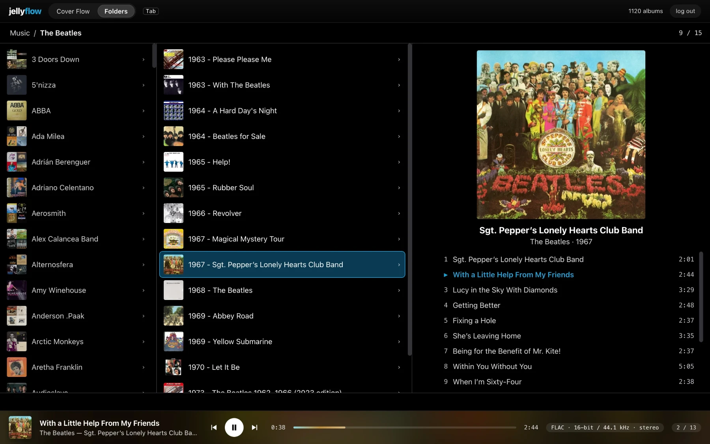

# jellyflow

Your [Jellyfin](https://jellyfin.org) music library, flipped through by album
cover (Cover Flow) or walked folder by folder with album art, all from the
keyboard with vim keys. It's the web sibling of
[coverflow](https://github.com/popconst/coverflow), the MPD terminal app,
with the same keys. A terminal version comes next and shares the same core.


<table>
  <tr>
    <td></td>
    <td></td>
  </tr>
  <tr>
    <td align="center"><code>Enter</code> opens an album like a gatefold sleeve</td>
    <td align="center">Folders, with vim motions</td>
  </tr>
</table>

- **Cover Flow:** a 3D row of covers that glides on a tap and runs ever
  faster while a key is held. `Enter` opens an album like a gatefold sleeve,
  its tracks on the inside page.
- **Folders:** the library as it is on disk, in columns like ranger or yazi,
  with album art throughout.
- **Search** by artist, album, year or any track title.
- **Playback** in the browser, the files streamed as they are (not
  transcoded), with the OS's media keys.
- **A spectrum** of what's playing, in the colours of the album's cover.
- **Remembers** what was playing and where you were, across reloads.
- **Light:** one runtime dependency, and no backend of its own. The page
  talks to your Jellyfin directly.

## Requirements

- A Jellyfin server with a music library. Developed against Jellyfin 12.4.
- Node.js 22.18 or newer, to build and serve it. Node runs the TypeScript as
  it is.
- A recent Chromium browser (Chrome, Brave): that's where it's developed and
  tested.

## Quick start

```sh
git clone https://github.com/popconst/jellyflow && cd jellyflow
npm install
npm run dev                    # http://localhost:5173, reloads as you edit
```

Log in with your Jellyfin server's address, user and password. To start the
login screen with your server filled in:

```sh
cp .env.example .env.local     # then set VITE_JELLYFIN_URL
```

The page talks to Jellyfin straight from the browser, so Jellyfin's CORS has
to allow it. Jellyfin allows any origin by default.

## Run it as a service

```sh
npm run build && npm start     # http://127.0.0.1:4173
```

`HOST` and `PORT` change where it listens. `server.ts` only serves the built
files and has no dependencies. To keep it running with
[pm2](https://pm2.keymetrics.io):

```sh
npm run build && pm2 start ecosystem.config.cjs
```

A rebuild is a redeploy: the server always serves what's in `dist/`.

## Keys

`?` shows them all. `Tab` switches between the two views.

**Everywhere:**
- `Space`: play / pause.
- `<` `>`: previous / next track.
- `c`: go to what's playing. `o` goes back to where you were before (`o` again: back to what's playing).
- `a`: add to the queue.
- `i`: the album's details. `d`, `w` and `m` open the album on Discogs, Wikipedia and MusicBrainz.

**Cover Flow** (coverflow's keys):

| Key | |
|---|---|
| `h` `l` / `←` `→` | previous / next album; hold to run, ever faster. Also scroll, or click a side cover |
| `H` `L` / PgUp PgDn | 10 back / forward |
| `g` `G` | first / last |
| `/` | filter by artist, album, year or track title (words in any order). `Enter` browses the matches, `Esc` cancels, `Ctrl-U` clears |
| `Esc` | the whole library again, at the same album |
| `Enter` | open the album: a page with its tracks swings out beside the cover, with the spectrum of what's playing under them. On it, `j` / `k` move, `Enter` plays from there (so `Enter` `Enter` plays the album), and `k` on the first track or `Esc` folds it shut |

**Folders** (like ranger or yazi: the folder above, this folder, and a preview):

| Key | |
|---|---|
| `j` `k` | down / up; counts work (`5j`) |
| `l` `h` | open / back up (also `-` and `Backspace`) |
| `Enter` | play the album, or the folder from this track |
| `gg` `G` `12G` | first / last / item 12 |
| `Ctrl-d` `Ctrl-u` `Ctrl-f` `Ctrl-b` | half page / page, down and up |
| `H` `M` `L` `zz` | top / middle / bottom of the screen; centre the cursor |
| `/` `n` `N` | find in this folder; next and previous match |
| `~` | the top folder |

## How it works

- **Albums** are Jellyfin's music albums, minus anything under a `Playlists/`
  folder. They're sorted by year, oldest first (albums without a year last),
  then by title, then by artist.
  - The year is the album folder's `YYYY - ` prefix when it has one (the
    original release), else the tags' year. The details show both when they
    differ.
- **Search by track** uses every track title in the library. The titles load
  in the background after the albums, a page at a time.
- **Live reload:** Jellyfin's websocket says when the library changed. Once
  the changes settle, both views read it again and stay where they were.
- **Folders** are the library's folders as they are on disk. A folder without
  a cover of its own shows up to four covers of the albums under it.
- **Playing** happens in the browser: a queue, auto-advance, and the OS's
  media keys and now-playing panel. Tracks are streamed as the files are
  (FLAC, MP3, …), not transcoded. The sound goes through Web Audio untouched,
  which the spectrum
  ([audioMotion-analyzer](https://github.com/hvianna/audioMotion-analyzer),
  1/24-octave bands coloured from the cover) listens to.
- **Remembered across reloads:** what's playing (the queue, the track and the
  second it was at), where Cover Flow was (album and filter), and the open
  folder with its cursor. If something was playing, it plays on and Cover
  Flow opens its album. The browser has to allow the site to start sound by
  itself (in Brave: site settings → Autoplay → Allow); if it doesn't, it
  plays on at the first key press or click.

## Privacy

Everything stays between your browser and your Jellyfin. The login (server,
user name and access token) and what's remembered across reloads are kept
in the browser's `localStorage`; logging out ends the session on the server
too. Nothing is sent anywhere else, except that `d` / `w` / `m` and the
details' links open the album on Discogs, Wikipedia or MusicBrainz when you
ask for them.

## Layout

```
src/core/   Jellyfin client, albums + search, details, vim key sequences,
            the row's motion. No DOM: plain TypeScript that Node runs as it
            is (type stripping), to be shared with the terminal app.
            tsconfig.core.json checks it without DOM types.
src/web/    Svelte 5 app: Cover Flow, Folders, the player, the spectrum.
server.ts   serves dist/ (no dependencies)
```

The one runtime dependency is audioMotion-analyzer (the spectrum, with no
dependencies of its own). Svelte, Vite and TypeScript are dev dependencies.

## Develop

```sh
npm run dev      # Vite, with hot reload
npm run check    # svelte-check (strict, warnings fail) + the core without the DOM
npm test         # node --test on src/core
npm run build    # into dist/
```

CI runs `check`, `test` and `build` on every push and pull request. Issues
and pull requests are welcome. Keep it light: new runtime dependencies need
a good reason.

## Next: the terminal

The terminal app will be `src/tui/`, run by Node, on the same `src/core`. Its
pieces:
- the same views drawn with kitty graphics (like coverflow);
- playback through `mpv --input-ipc-server` on `Jellyfin.streamUrl()`.

## License

[MIT](LICENSE)
